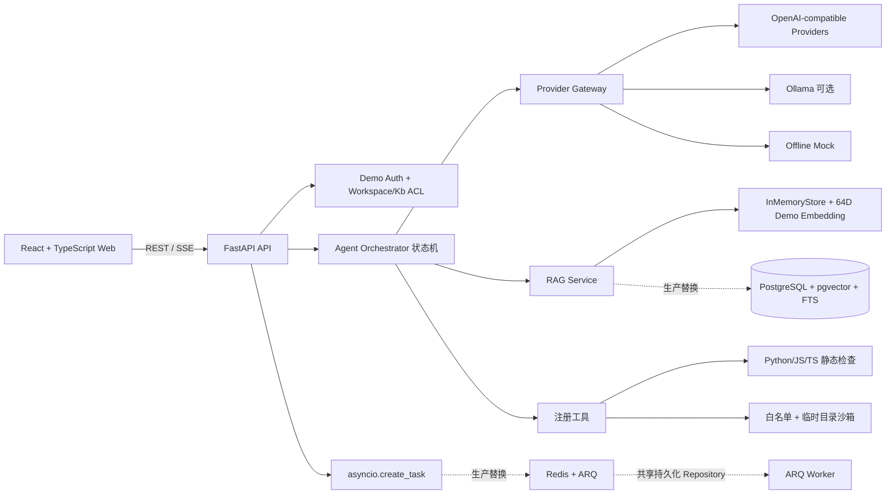

# 系统架构

## 请求主链路（当前离线 MVP）

1. React 通过 REST 登录、选择工作区/知识库、上传文档，并轮询索引任务状态。
2. FastAPI 在 API 层检查 `workspace_id`、`knowledge_base_id` 和用户角色；浏览器永远不接触 API Key。
3. `TaskService` 用 `asyncio.create_task` 执行解析、分块和确定性 64 维 Embedding，结果写入 `InMemoryStore`。
4. `AgentOrchestrator` 使用固定状态机发出 `plan -> retrieval -> tool -> answer_delta -> citation -> done` SSE 事件。
5. `HybridRetriever` 同时计算向量相似度和关键词分数，用 RRF 融合；无可靠候选时直接拒答。
6. 如用户提交代码，工具层执行 Python/JS/TS 静态检查和只允许语法检查的安全沙箱；高风险 Patch 只发出 `approval_required` 事件。

## 生产替换 seam

- **Repository**：`src/backend/app/services/postgres_store.py` 提供 PostgreSQL + pgvector 的异步查询实现。检索 SQL 先 JOIN `workspace_members`、`knowledge_bases`、`documents`，再按工作区、知识库、文档类型和标签过滤，然后进行 pgvector、tsvector 与 RRF。它是替换接口，不是当前默认运行主链路。
- **Queue**：`src/backend/app/services/queue.py` 提供 Redis/ARQ enqueue 入口，`src/backend/app/worker.py` 提供 ARQ Worker 入口。当前 Worker 自己创建 `InMemoryStore`，与 API 进程不共享数据，因此不能宣称 Docker 启动后已完成真实持久化异步索引；接入生产时应让 API 与 Worker 共同使用 PostgreSQL Repository。
- **Embedding**：Demo 使用 64 维确定性 Hash 向量，迁移示例使用 `vector(1536)`。生产必须在 Provider Gateway 中实现云端 `/embeddings`，并保证文档与 Query 使用同一模型和维度。

## 关键模块

- `ProviderGateway`：统一封装 OpenAI-compatible chat 流式调用、Ollama 和 Mock；模型白名单只返回后端已配置供应商。
- `HybridRetriever`：权限和筛选后执行向量召回、关键词召回及 RRF 融合，生成带文档/代码位置的 Citation。
- `AgentOrchestrator`：固定状态机，不让 LLM 直接执行任意命令；工具必须经过注册和安全策略。
- `TaskService`：统一任务状态模型；离线用 asyncio，生产可替换 Redis/ARQ。
- `SandboxRunner`：临时目录、白名单命令、超时、输出上限和敏感文件拦截。

## 安全边界

- API Key 只从后端 `.env` 读取，前端仅请求模型元数据。
- 所有检索都带用户和工作区上下文；生产 SQL 必须在召回前 JOIN 成员权限表。
- ZIP 拒绝路径穿越、加密文件、超大单文件和超大总内容，并跳过 `.env` 等敏感文件。
- 沙箱不挂载宿主机目录，不允许任意 shell；Patch 必须人工确认且只允许作用于临时工作区。
